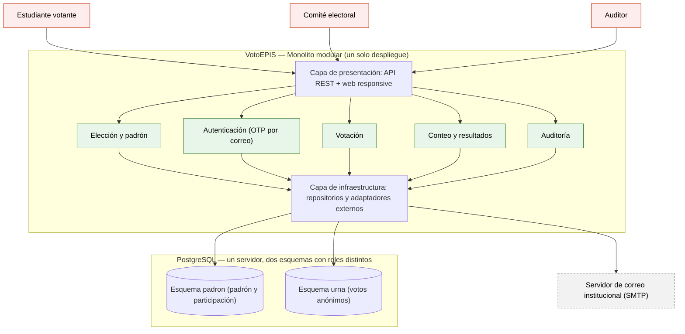
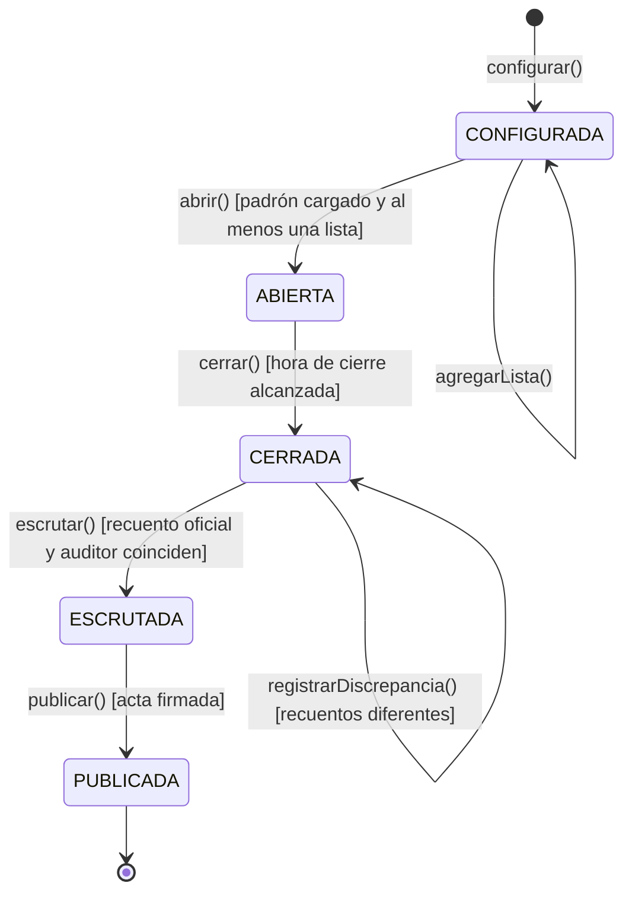
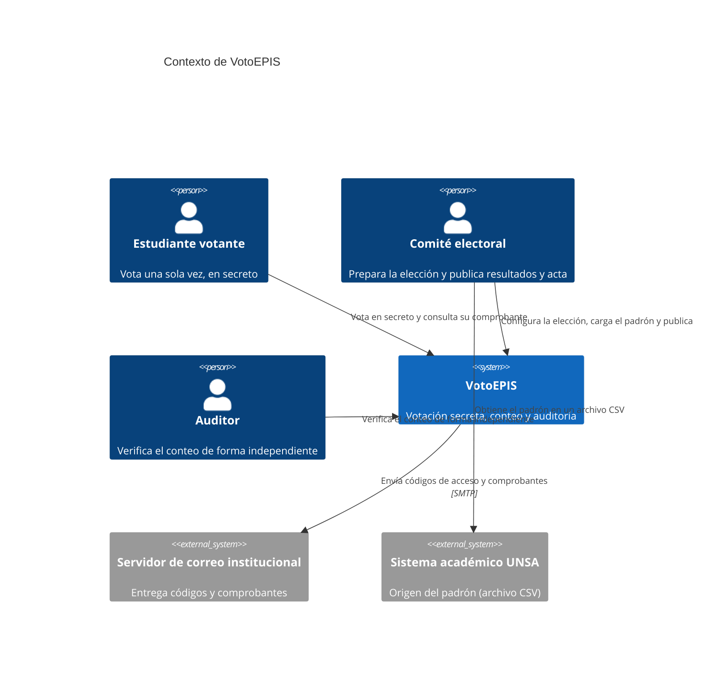

# VotoEPIS — Laboratorio 04: Fundamentos de arquitectura de software

Construcción de Software · EPIS-UNSA · 2026-B · Grupo 05

## Integrantes

| Nombre | Rol en el laboratorio |
|---|---|
| Eduardo Choque | Todos: redacción de ADR, diagramación, verificación con IA y documentación |

## Caso

VotoEPIS es una plataforma web para la elección digital de delegados estudiantiles de la EPIS. Los estudiantes votan una sola vez y en secreto; el comité electoral gestiona el padrón y publica los resultados y el acta; y un auditor puede verificar el conteo de forma independiente.

El MVP debe estar en producción en un mes, con un equipo de tres desarrolladores y un único servidor de bajo costo. El **atributo de calidad crítico** es la seguridad (integridad y confidencialidad): cero votos duplicados y un recuento independiente que coincida al 100 % con el oficial.

## Arquitectura elegida

Se eligió un **monolito modular (ADR-001)**. Cada módulo cubre al menos un requisito de `docs/architecture/drivers.md`:

- Elección y padrón: RF-01 y RF-07.
- Autenticación: RF-02.
- Votación: RF-03 y RF-08.
- Conteo y resultados: RF-04 y RF-05.
- Auditoría: RF-06.

## Documentación

- [Drivers y escenarios de calidad](docs/architecture/drivers.md)
- [Matriz de decisión](docs/architecture/matriz-decision.md)
- [Bitácora de uso de IA](docs/architecture/bitacora-ia.md)
- Alternativa descartada: [alternativa.puml](docs/architecture/diagramas/alternativa.puml)
- Vista de despliegue: [despliegue.py](docs/architecture/diagramas/despliegue.py)

## Decisiones arquitectónicas

- [ADR-001: Estilo arquitectónico (monolito modular)](docs/architecture/adr/001-estilo-arquitectonico.md)
- [ADR-002: Separar identidad y voto en dos esquemas](docs/architecture/adr/002-anonimato-del-voto.md)
- [ADR-003: Autenticación con OTP al correo institucional](docs/architecture/adr/003-autenticacion-otp-correo.md)

## Reflexión sobre el uso de la IA

La IA me ayudó a generar y comparar alternativas, redactar el código de los diagramas y anticipar riesgos mediante la crítica adversarial, especialmente el de correlacionar el voto con el votante. También cometió errores: asumió un inicio de sesión federado que no tenía confirmado y tendió a sobredimensionar la solución. Aprendí a darle restricciones explícitas, recalcular con un script los resultados que proporciona y registrar cada corrección en la bitácora. Verifiqué la coherencia entre los requisitos, las decisiones arquitectónicas y los diagramas. También revisé los falsos positivos y los riesgos relacionados con el anonimato del voto. Las decisiones finales y los riesgos aceptados, como el acceso total del administrador a la base de datos, fueron responsabilidad mía.

## Diseño UML (Lab 05)

Se desarrolla el diseño detallado de la historia **HU-03: emitir un voto secreto**, en coherencia con el [ADR-001](docs/architecture/adr/001-estilo-arquitectonico.md), que establece un monolito modular con puertos y adaptadores, y con el [ADR-002](docs/architecture/adr/002-anonimato-del-voto.md), que establece la separación entre identidad y voto.

### Máquina de estados de la elección

Se ajusta el flujo para que la elección solo pase a `ESCRUTADA` después de completar el recuento oficial y la verificación independiente del auditor. Si existe una discrepancia, la elección no debe avanzar a `ESCRUTADA` ni publicarse el acta.

**Condición de consistencia:** la transición a `ESCRUTADA` debe ejecutarse únicamente cuando el recuento oficial y el independiente coincidan y se hayan cumplido las verificaciones correspondientes. Si existe una discrepancia, se debe mantener la elección en `CERRADA` hasta resolverla. El acta no podrá publicarse mientras no esté firmada y validada conforme a las reglas del sistema.

### Diagramas y documentos

- Historia y criterios: [historia.md](docs/design/historia.md)
- Diagrama de clases: [clases.puml](docs/design/clases.puml)
- Diagrama de secuencia: [secuencia-emitir-voto.puml](docs/design/secuencia-emitir-voto.puml)
- Diagrama de actividades: [actividades-escrutinio-acta.puml](docs/design/actividades-escrutinio-acta.puml)
- Diagrama de paquetes: [paquetes.puml](docs/design/paquetes.puml)
- Round-trip: [round-trip.md](docs/design/round-trip.md)
- Consistencia: [consistencia.md](docs/design/consistencia.md)
- Bitácora de IA: [bitacora-ia.md](docs/design/bitacora-ia.md)
- Código generado: `src/votacion/dominio.py`
- Imágenes: `docs/design/img/`

### Correcciones derivadas de la revisión con IA

| Regla | Hallazgo | Verificación del equipo | Estado |
|-------|----------|-------------------------|--------|
| C2 / entre diagramas | En [actividades-escrutinio-acta.puml](docs/design/actividades-escrutinio-acta.puml) la elección pasa a ESCRUTADA antes del recuento del auditor. Si el auditor reporta una discrepancia, la elección queda en ESCRUTADA y el diagrama de estados no tiene una transición para revertirla o anularla | Es un hallazgo real: la guarda de `publicar()` solo exige acta firmada, y el acta no se firma si hay discrepancia, así que no se publica. Pero el estado queda sin salida | Corregido |
| C3 | Voto no está asociado a Participacion ni a Estudiante: «relación faltante» | Falso positivo confirmado: la ausencia de esta asociación es deliberada, conforme a R-06 y ADR-002. Relacionar directamente Voto con Estudiante permitiría identificar por quién votó cada estudiante, comprometiendo el secreto del voto. | Descartado: falso positivo justificado |
| C1 | `VotoController` y `Web de votación` reciben mensajes pero no existen en el diagrama de clases | La regla C1 se aplica a las clases del dominio y de los puertos; controlador y web pertenecen a la capa de presentación, fuera del alcance de la historia | Aceptado como limitación |
| C4 | `votacion` depende de `autenticacion` | Permitido por ADR-001 solo para el identificador de sesión; la dependencia está etiquetada así | Verificado |

## Arquitectura C4 (Lab 06)
Modelo único en [workspace.dsl](docs/architecture/c4/workspace.dsl) (Structurizr DSL), coherente con el [ADR-001](docs/architecture/adr/001-estilo-arquitectonico.md) y con el diseño del Lab 05.

### Contexto del sistema

### Vistas (imágenes en `docs/architecture/c4/img/`)
- Contexto: [structurizr-Contexto.png](docs/architecture/c4/img/structurizr-Contexto.png)
- Contenedores: [structurizr-Contenedores.png](docs/architecture/c4/img/structurizr-Contenedores.png)
- Componentes de la API: [structurizr-Componentes.png](docs/architecture/c4/img/structurizr-Componentes.png)
- Dinámica (emitir un voto): [structurizr-EmitirVoto.png](docs/architecture/c4/img/structurizr-EmitirVoto.png)
- Despliegue: [structurizr-Despliegue.png](docs/architecture/c4/img/structurizr-Despliegue.png)
- Nivel 4 (código): [clases.puml](docs/design/clases.puml) del Lab 05

### Documentos
[inventario.md](docs/architecture/c4/inventario.md) · [comparacion.md](docs/architecture/c4/comparacion.md) · [revision-c4.md](docs/architecture/c4/revision-c4.md) · [explicacion.md](docs/architecture/c4/explicacion.md) · [bitacora-ia.md](docs/architecture/c4/bitacora-ia.md) · [contexto-manual.puml](docs/architecture/c4/contexto-manual.puml)

## Notas

- Las imágenes de `diagramas/img/` se generan desde el código fuente de los diagramas. Consultar la lista de verificación de E3, E5 y E6 en la guía.
- La separación entre el padrón y la urna debe conservarse en los diagramas, las interfaces y la implementación, evitando asociaciones que permitan identificar al autor de un voto.
