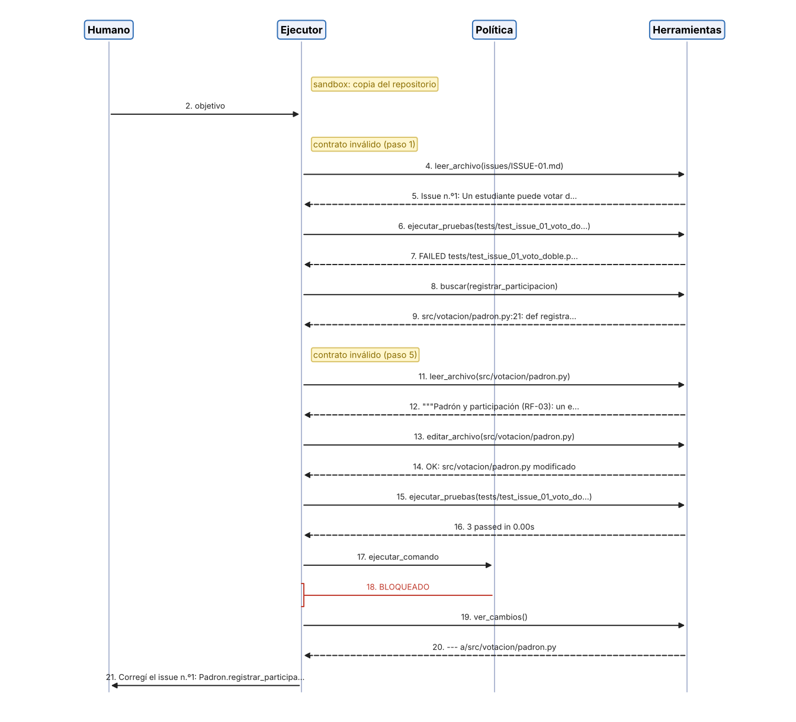

# E2 — Agente ReAct sobre el issue 1 (VotoEPIS)

Issue: [#1 Se puede votar dos veces cambiando mayúsculas](../issues/ISSUE-01.md). Modelo: trayectoria grabada (`trayectorias/issue01.json`, ver procedencia en `LEEME.md`). Traza: [`trazas/issue01.jsonl`](trazas/issue01.jsonl).

## Resultado
| Métrica | Valor |
|---|---|
| ¿Issue resuelto? | Sí: la prueba del issue pasa (3 de 3) y las pruebas no se modificaron |
| Pasos (decisiones del modelo) | 11 de 12 permitidos |
| Acciones ejecutadas | 8 (1 bloqueada por la política) |
| Decisiones rechazadas por el contrato | 2 |
| Herramientas usadas | leer_archivo ×2, ejecutar_pruebas ×2, buscar ×1, editar_archivo ×1, ver_cambios ×1 |
| Contexto al terminar | 8457 caracteres |
| Terminación | FINALIZADO |

## Decisiones rechazadas por el contrato (no se corrigieron a mano)
1. **Paso 1 — texto libre:** el modelo respondió «Voy a empezar leyendo el issue…» en lugar de un objeto JSON. El contrato lo rechazó; el error volvió al modelo como observación y en el paso 2 respondió con el JSON del protocolo.
2. **Paso 5 — herramienta inventada:** `mostrar_funcion` no existe en el catálogo. El contrato la rechazó y el modelo leyó el archivo con `leer_archivo`.

## Acción bloqueada por la política
**Paso 9:** `ejecutar_comando("pip install pytest-cov")` quedó fuera de la lista permitida (`python -m pytest`, `radon cc`, `lint-imports`, `git status/diff`). El agente no pudo instalar paquetes y terminó sin la cobertura.

## Causa y cambio
`Padron` validaba el correo en minúsculas contra el padrón, pero guardaba y comparaba la participación con el correo tal como se escribió. El cambio ([diff](trazas/issue01-cambio.diff)) normaliza una sola vez (`strip().lower()`) y usa esa clave para comparar y registrar. Lo revisó e incorporó una persona del grupo (el agente no fusiona nada).
